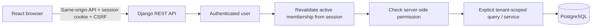

# Architecture and invariants

## Request flow

Users are global identities. Membership joins a user to a tenant and carries that station's role and permission overrides. A tenant owns one station profile. Users with several active memberships authenticate before selecting an authorized station. Super Admin starts in a separate platform context, with no automatic station access. A tenant is the client boundary, not a request-supplied identifier. Subdomain/domain resolution can be added later as a hint, followed by membership validation.

The session contains `active_tenant_id` only after login or explicit selection verifies active membership. Selection rotates both the session key and CSRF token. Every protected tenant request rechecks membership, tenant activation and effective permissions. Neither query parameters, request bodies nor `X-Tenant-ID` headers select a tenant. The selection API verifies ownership of the requested membership. Super administrators receive no station permission bypass.

## Database foundation

| Entity | Ownership and relationships |
| --- | --- |
| User | Global custom UUID user; Django hashes passwords |
| Tenant | Global client registry, UUID, unique slug, activation and branding fields |
| Membership | Tenant-owned user/role association; unique `(tenant, user)`; validated permission overrides |
| RolePolicy | Tenant-owned optional replacement permissions for each station role |
| Employee | Tenant-owned profile, one per membership; access remains on membership |
| Station | Tenant-owned station profile; unique tenant; language/currency/timezone/settings |
| ComplianceRecord | Tenant-owned descriptive authority/reference/dates/status/metadata records |
| AuditLog | Tenant-owned action/actor/object/safe change data; indexed by tenant/time |
| PlatformAuditLog | Global registry/access events, visible only to Super Admin |
| FuelProduct / FuelPriceHistory | Tenant-owned fuel configuration and read-only API price snapshots |
| Tank / Pump / Nozzle | Tenant-owned equipment with validated product/equipment relationships |
| DailyClosing / Shift / NozzleAssignment | Station operating day, attendant cash handover and exclusive active nozzle assignments |
| MeterReading / FuelSale | Meter interval, captured price/tax and cash/bank/credit allocation with correction history |
| Supplier / FuelPurchase | Supplier configuration, deliveries, paid/unpaid amounts and preserved reversal history |
| Customer / CustomerPayment | Opening debt, credit limit, sale debt and cash/bank collection records |
| InventoryMovement / PhysicalStockReading | Signed stock ledger and measured-versus-book snapshots |
| CashMovement / OperationRequest | Signed cash ledger and tenant/actor-bound replayable submission results |

`TenantOwnedModel` provides a protected tenant FK, UUID, timestamps and actor fields. Public application code reads using `Model.objects.for_tenant(request.tenant)`. `Model.objects.all()` fails immediately. `all_tenants` is deliberately unrestricted for trusted authentication lookups, provisioning and Django constraint/relationship internals; it is never a substitute for scoped tenant-facing queries. This is application-level isolation, not PostgreSQL row-level security. New endpoints and service operations must have isolation tests.

The scoped manager filters reads; it is not a write-authorization mechanism. Shared tenant viewsets assign tenant and actor from validated server context, scope related serializer choices, run model validation, and lock the tenant row inside atomic writes. Operational services use the same tenant lock and recheck membership/permissions before posting. PostgreSQL composite foreign keys enforce matching tenant IDs for configuration and operational relations; nozzle/assignment tank/product must also match. SQLite migrations supply equivalent relationship triggers for local development. `validate_tenant_links` supplies friendly validation but is not automatically invoked by arbitrary `save` or bulk operations. New business models require equivalent constraints and isolated service entry points.

Employee names and profile changes remain local to the station. Employee activation revokes only that membership, preserving access to other stations. Station administrators cannot reset shared-user or superuser passwords. Global identity edits and membership assignments belong to the platform API; password changes by the account holder invalidate other sessions. Owner and system administrator removal rules preserve a remaining active administrator.

## Domain boundaries

| Domain | Responsibility and status |
| --- | --- |
| accounts, tenants, employees, stations | Implemented identities, membership, configurable permissions, employee access, station branding/settings and compliance |
| fuel | Implemented products, price history, tanks, pumps and nozzles |
| operations | Implemented shared posting, idempotency, validation and API coordination |
| shifts | Implemented assignments, close/reopen rules and drawer reconciliation |
| sales | Implemented meter readings, sales, payment allocation and printable receipts |
| purchases, suppliers | Implemented deliveries, paid/unpaid amounts and reversals; supplier payments/statements remain |
| inventory | Implemented signed fuel movements and explicit physical-stock reconciliation |
| customers | Implemented credit sales, payments, limits and balances; full statements remain |
| cash | Implemented operating days, cash movements and daily closing/reconciliation |
| expenses, reports | Reserved for expenses, costing, accounting reports and exports |
| audit | Implemented safe events; broader history browsing remains for Prompt 4 |

Reserved packages are not installed Django apps until their models/APIs are implemented. Do not create speculative business models or migrations for later phases.

## Service and integrity conventions

- Centralize business calculations in Python services using `Decimal` and PostgreSQL `NUMERIC`. API money/quantities are decimal strings; frontend arithmetic does not determine authoritative totals.
- Prices use four decimal places, quantities/meters three, and money two with `ROUND_HALF_UP`. PostgreSQL `NUMERIC` is required for real financial posting; SQLite's approximate decimal storage is a development fallback.
- Purchases, sales and shifts post atomically under the station row lock, writing inventory/cash/audit records together. UUID idempotency keys bind to tenant, actor, operation and request fingerprint; successful retries replay the stored result.
- Meter-derived totals post stock once; payment collection posts cash/debt without another stock movement. Assignments capture prices and exclusive tax rates when a shift starts. Price changes apply to new shifts. General meter resets and price changes within an assignment require future workflows.
- Preserve financial and meter history through cancellation/reversal/correction; prevent arbitrary changes to closed shifts/days. Require authorized reasons for reopen/adjustments.
- Estimated profit is operational reporting, not full double-entry accounting. Distinguish consumed fuel cost from purchases made within the reporting period; choose costing methodology before financial reporting.
- Physical stock readings and estimated stock remain separate; compliance configuration stores information without implementing legal judgments.

## API and security conventions

All endpoints use `/api/v1/`; [Prompt 2 documents configuration/authentication](phase-2.md), and [Prompt 3 documents operational endpoints and business rules](phase-3.md). Successful single-resource responses are JSON objects. Resource lists use DRF's `{count, next, previous, results}` pagination, with 25 records by default and a maximum page size of 200. Errors use `{error: {code, message, details?}}`; frontend translations map stable codes to friendly language. Global exceptions log developer details and return a generic message. API code does not echo submitted passwords or raw exception messages.

Authentication is server-side Django sessions with HTTP-only cookies, secure flags in production, login session rotation and logout invalidation. CSRF is explicitly enforced on anonymous login as well as authenticated writes. Get `auth/csrf/` before the first unsafe request; use the rotated token returned by login. POST logout remains available if tenant access is revoked. No tokens/passwords are stored in browser storage. Session/profile responses disable caching.

The login throttle uses an IP key. Debug defaults to process-local caching; production requires Django's shared database cache, initialized with `createcachetable`. Forwarded IPs are ignored by default; the deployment template sets one trusted hop and overwrites forwarded headers. Proxy login limits supplement DRF's approximate throttle. Account-aware controls remain future work. JSON request sizes are bounded and return a safe 413 error when exceeded. Logo uploads accept decoded PNG/JPEG/WebP images up to 2 MB and 2048 pixels per dimension, reencode to fresh PNG, and use generated tenant storage paths. Owner uploads require station permission; platform uploads require active Super Admin status and produce platform audit events. The authenticated station-logo route remains scoped. A separate read-only branding API intentionally publishes only an active station's name, code, color and sanitized logo for `/login?station=SLUG`; it exposes no directory, users or financial data and never selects the session's tenant. Production must not expose the media directory directly. Django admin exposes global users only, and provisioning is also available as an explicit operator command.

## Frontend and connectivity

`features/auth` owns session state, `features/station` owns the shared profile/branding, `features/operations` owns worker posting and operational ledgers/receipts, and `services/api.ts` owns cookies/CSRF/timeouts/error handling. Components display backend quotes and totals. Shared resource schemas provide setup tables/forms. Tenant changes remount station context and clear the preceding station's UI. Branding colors include a calculated accessible foreground. Workers have three navigation links and a simple shift workflow; owners/managers have permission-controlled transaction and configuration tables. Every route restriction is paired with server permission checks.

Translation keys live in complete `fa`, `ps` and `en` dictionaries. Dari defaults to `fa-AF`, Pashto to `ps-AF`; both set `dir=rtl`, and CSS uses logical inline properties. Page titles use the selected translation. An explicit language selection is persisted locally; otherwise the active station's language applies. Station currency defaults to AFN; timezone defaults to Asia/Kabul. Gregorian dates are the foundation; other calendars/date display requirements should be confirmed in the localization phase. Have native Dari/Pashto speakers review terminology before rollout.

The overview uses persisted operating-day, cash and stock data. Login input remains in component memory after failed requests; credentials are never saved as drafts. Buttons prevent concurrent submission, and requests have timeouts and friendly retry errors. Transaction forms retain their UUID and values in component memory after a failed request, enabling safe retries while mounted. The connection label reports the browser's network flag, not server health. Durable draft recovery after refresh, offline submission and synchronization remain for Prompt 5.
